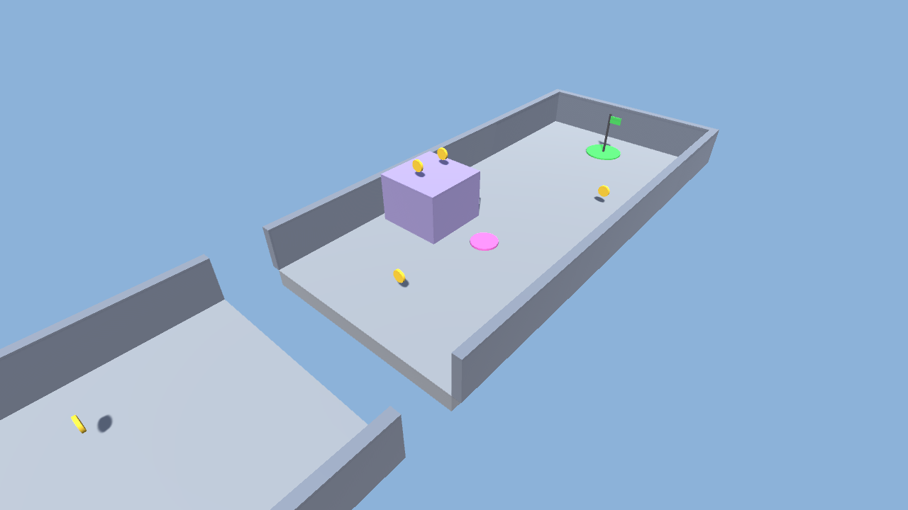
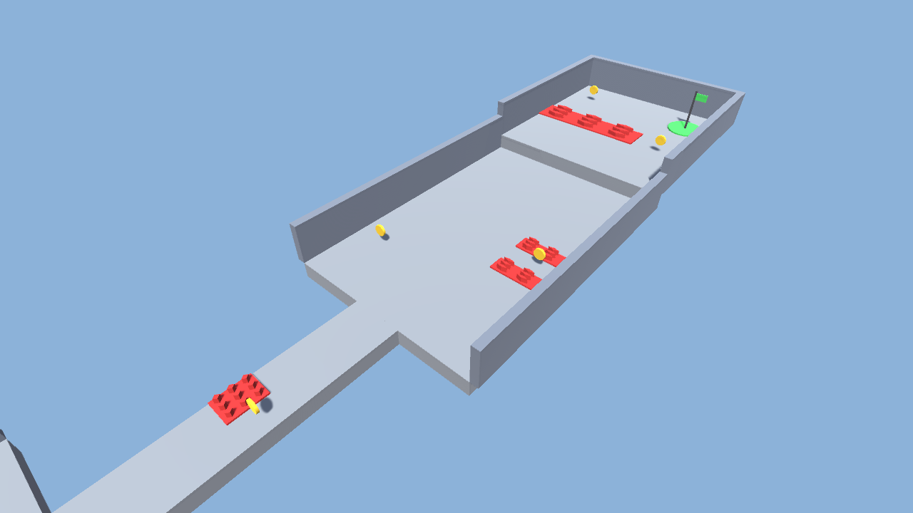
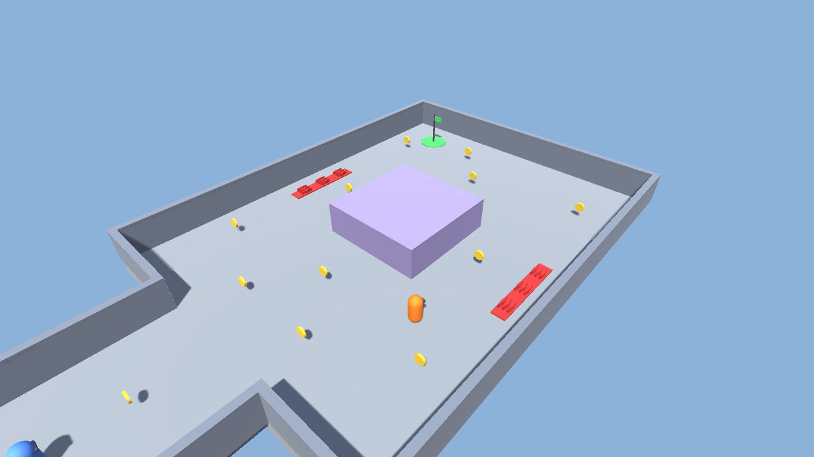
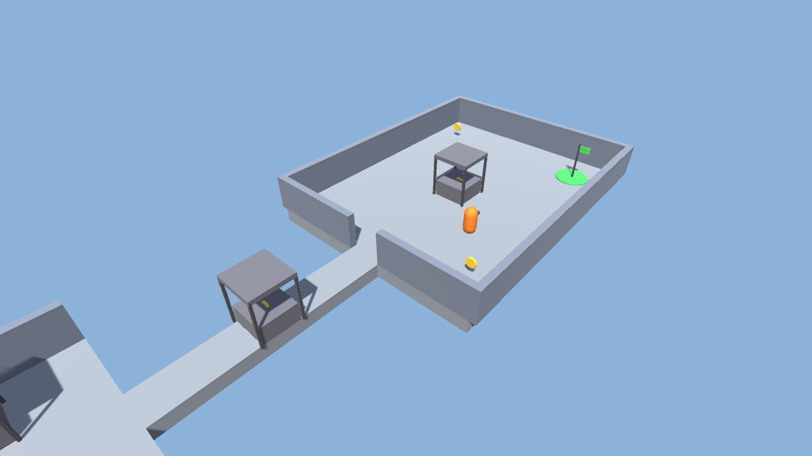
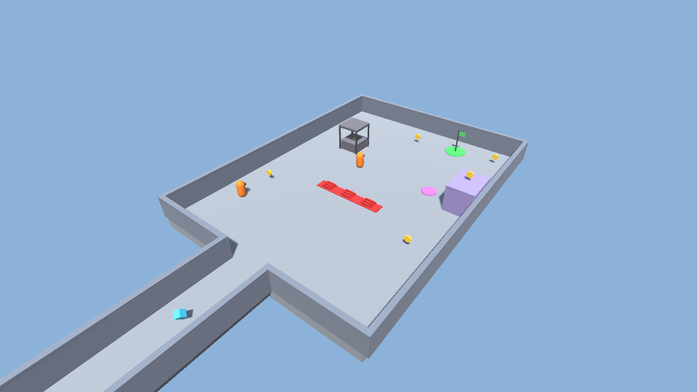

# CS464 Assignment 03 · Mayasa Fakhar · BSCS23069

- **Video (60–120 s):** https://drive.google.com/file/d/1Cw5-_Xo8BsvtkP-Frc5jWw8LHSaTJVvO/view?usp=sharing
- **Project:** a new Unity 6.3 project (6000.3.27f1) with five new scenes, built for this assignment. Only the player controller, camera follow and easing scripts come from my Assignment 02, since this assignment builds on that controller
- **Controls:** WASD or the arrow keys to move (the camera is behind you, so W is always forward), Space to jump
- **To win a level:** collect enough coins to open the goal (Level01 6 of 6, Level02 5 of 6, Level03 8 of 12, Level04 5 of 6, Level05 6 of 7), then reach the green flag

## Levels

| Level | Screenshot | New idea | Combined with |
|---|---|---|---|
| Level01 |  | Coins, the goal, and a pink bounce pad next to a 3 m block with two coins on top | Nothing hurts yet. There is one 3 m pit across the level, which the 1.8 m jump clears easily, so a fall can cost a life but you learn it safely |
| Level02 |  | Spikes, a heart at a time. The first patch is beside the start, off the route, so you can touch it safely | A 3 m walkway with no walls and spikes on half of it, a coin between two spike strips 1.4 m apart, and a step up to a terrace mostly covered in spikes |
| Level03 |  | A guard that patrols a loop round the big block, chases you inside 6 m and gives up at 9 m | Spikes just outside its loop, so running away carelessly costs a heart, and coins on its route |
| Level04 |  | The crusher. The first one is beside the start, off the route, with a coin on it | A crusher on a bridge exactly as wide as it, so you have to time it, and a guard walking a loop round the last crusher |
| Level05 |  | Two speed pickups 16 m apart in the corridor, so the second one comes 1.7 s after the first | Everything so far: a ping-pong guard, a guard that chases, spikes, a crusher near the goal and a bounce pad up to a coin on a pillar |

## The numbers

| Number | Value | Why this value |
|---|---|---|
| Patrol speed | 2 m/s | A third of my 6 m/s run, so you can walk past a guard's route without it feeling like a race. |
| Chase speed | 3.5 m/s | Still slower than the 6 m/s run, so you always gain 2.5 m/s on a guard by running away. |
| Chase range | 6 m, give up at 9 m | The guard's loop in Level03 is 13 m by 13 m round an 8 m block, so with 6 m it notices you when you come round its side of the block, not from across the yard. You get from 6 m to 9 m in 3 / 2.5 = 1.2 s of running, and because it only gives up at 9 m it can't flicker between chasing and not at one edge. |
| Knockback | 8 N·s, Impulse, and 0.25 s with no steering | The player is 1 kg, so it's 8 m/s straight away from the hazard. For 0.25 s that is about 2 m, and in play it threw me 1.76 m. That is enough to clear the 1 m spike strips and the edge of a 2.4 m crusher pad. |
| I-frames | 1 s | The knockback has you clear in 0.25 s and at 6 m/s you're off a 3 m patch in 0.5 s, so 1 s is enough time to get away. Standing still on the spikes still costs one heart a second, not fifty. |
| Power-up duration | 5 s at ×1.6 | 9.6 m/s for 5 s is 48 m. That gets you down the 24 m corridor and well into the 33 m yard in Level05, but not across the whole 66 m level, so where you use it matters. |
| Bounce speed | 9 m/s, VelocityChange | v² / 2g = 81 / 19.6 = 4.1 m, and in play the player went up 4.12 m. The blocks in Level01 and Level05 are 3 m, so you land on top with room to spare. |
| Crusher warning | 0.7 s, after 2 s of rest, strike 0.4 s | 0.7 s is well over a reaction time of about 0.25 s, so you can see the warning and still get off the 2.4 m pad. |
| Respawn | after 0.6 s, with 1.5 s of protection | The beat stops the hit's knockback landing on the respawned player, and the protection means a guard near the start can't take a heart as soon as you appear. |

## Short answers

**1. Why does a trigger need a Rigidbody on at least one of the two objects?**

Unity only checks a pair of colliders for overlaps when at least one of them is attached to a Rigidbody. Two colliders with no Rigidbody are treated as static scenery, so OnTriggerEnter is never called. In my game the player's Rigidbody is what makes the coins, spikes, bounce pad, goal and kill zone fire. The guards move themselves, so each has its own kinematic Rigidbody as well.

**2. Which ForceMode do your knockback and your Part A force use, and why each?**

The knockback is `ForceMode.Impulse` with 8, called once when a hit lands. It's one kick that depends on mass, so the 1 kg player goes off at 8 m/s, and `Knockback()` stops my controller steering for 0.25 s so the next step doesn't wipe it. The bounce pad uses `ForceMode.VelocityChange`, also once, from `OnTriggerEnter`. It ignores mass, and I subtract the current falling speed first, so every bounce goes up at exactly 9 m/s however you land on it.

**3. What does your code do when a second power-up is picked up while one is running?**

It refreshes. `BoostSpeed` stops the running `Boost` coroutine with `StopCoroutine` and starts a new one, so the 5 s start again from the second pickup. Two pickups 3 s apart end the boost at 8 s, and my test checked it was still on at 7.3 s and off after 8 s. The coroutine runs on the player, so destroying the pickup doesn't stop the timer.

**4. Why can `==` fail as an arrival check, and when does it work?**

`Vector3 ==` is only true when the two points are within about 0.00001 m. A guard moving a whole step each frame (3.5 m/s × 0.02 s = 7 cm) almost never lands that close, so it overshoots, turns round and shivers on the waypoint. It only works straight after `Vector3.MoveTowards`, which lands exactly on the target on the last step. I check arrival by distance instead, with `arriveDistance` 0.1 m, which is bigger than one step.
